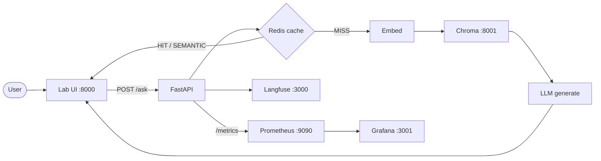
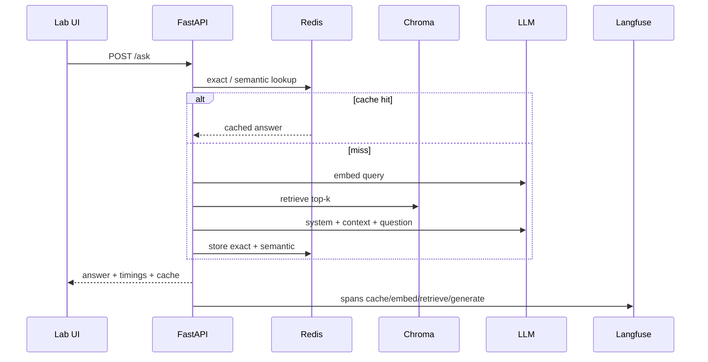
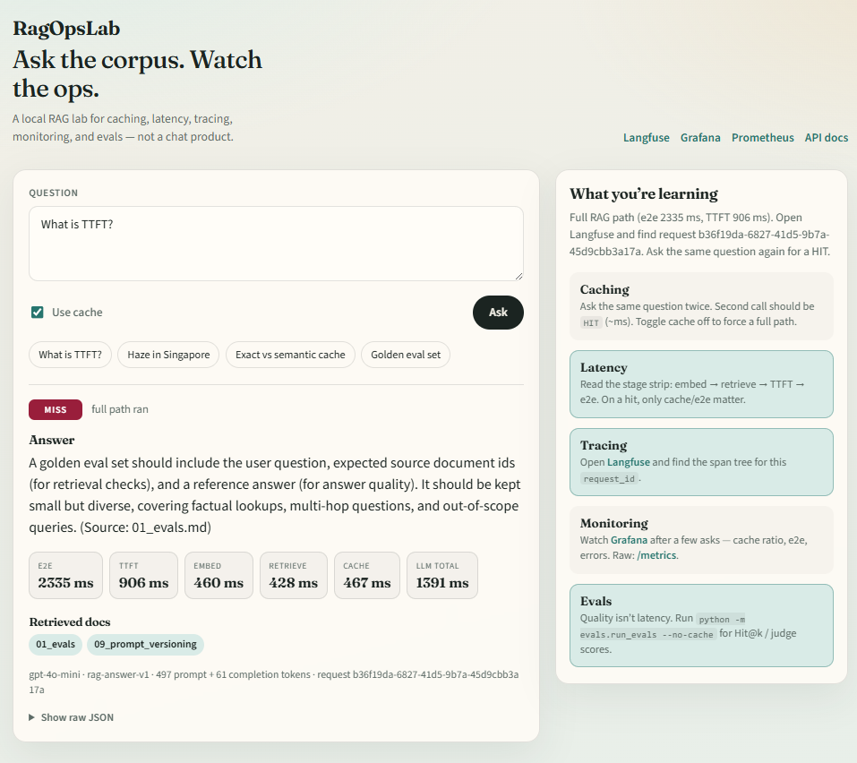
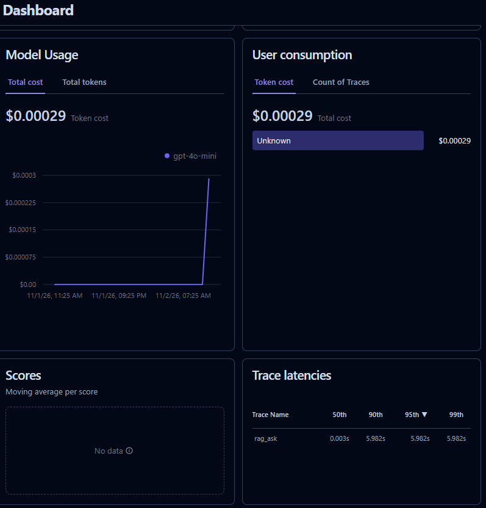
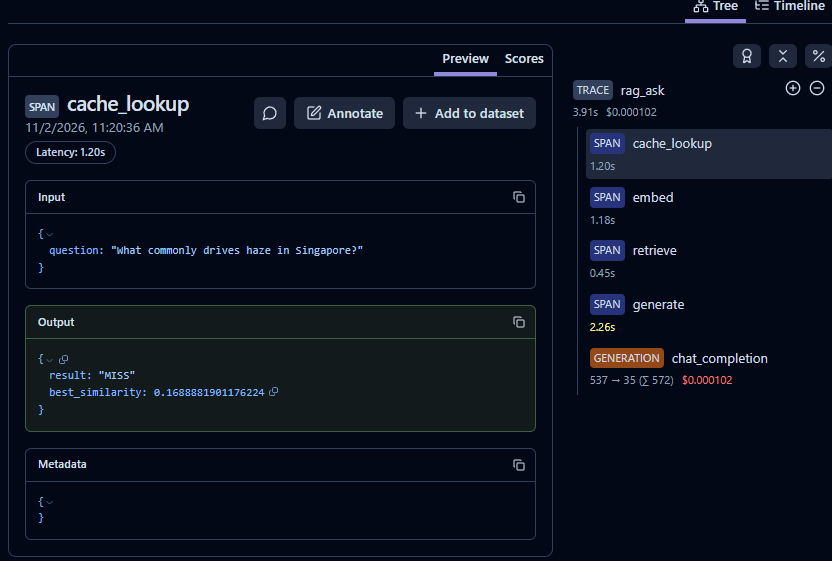
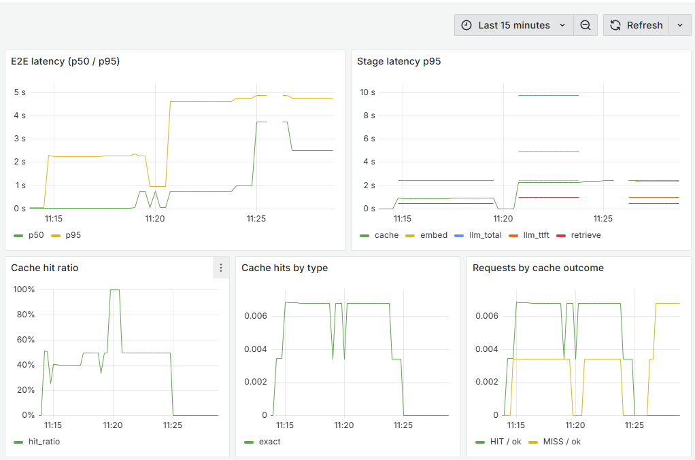

# RagOpsLab

Local lab for **RAG ops**: caching, latency, tracing, monitoring, and evals — not a chat demo.

## Architecture



**Request path (MISS):** cache lookup → embed → retrieve (Chroma) → generate (context chunks in the prompt) → store caches.



## Localhost map

| Service | URL | Notes |
|---------|-----|--------|
| **Lab UI** | http://localhost:8000 | Ask + timings + learning guide |
| API docs | http://localhost:8000/docs | Swagger |
| Metrics | http://localhost:8000/metrics | Prometheus scrape target |
| **Langfuse** | http://localhost:3000 | Traces / span trees |
| **Grafana** | http://localhost:3001 | `admin` / `admin` → Dashboards → **RAG** → **RAG Ops Lab** |
| Prometheus | http://localhost:9090 | Raw metrics |
| Redis | `localhost:6379` | Exact + semantic cache |
| Chroma | `localhost:8001` | Vector store (Docker) |

## Screenshots

**Lab UI** — answer, cache badge, stage timings, retrieved docs:



**Langfuse** — overview + per-request span tree (`cache_lookup` → `embed` → `retrieve` → `generate`):





**Grafana** — e2e / stage latency, cache hit ratio:



## Quick start

```bash
docker compose up -d

python -m venv .venv
# Windows: .\.venv\Scripts\Activate.ps1
# macOS/Linux: source .venv/bin/activate
pip install -r requirements.txt

cp .env.example .env
# set OPENAI_API_KEY
# Langfuse: open :3000 → sign up → project → Settings → API Keys → paste into .env

set PYTHONPATH=.          # Windows PowerShell: $env:PYTHONPATH = "."
python -m app.rag.ingest  # embeds corpus into Chroma
uvicorn app.main:app --host 0.0.0.0 --port 8000
```

Open http://localhost:8000 — or `curl` `/ask` if you prefer the API.

## Learning loops

| Topic | Try this |
|-------|----------|
| **Caching** | Ask twice → `HIT` (~ms). Paraphrase → often `SEMANTIC` (≥ `0.92` sim). `use_cache: false` forces MISS. |
| **Latency** | Read UI timings / Grafana p50–p95. `python scripts/bench.py --rounds 2` |
| **Tracing** | Langfuse → open `rag_ask` → span tree + generation I/O |
| **Monitoring** | Grafana **RAG Ops Lab**; raw `/metrics` |
| **Evals** | `python -m evals.run_evals --no-cache` → Hit@k / MRR / judge. Flip `PROMPT_VERSION=rag-answer-v0-broken` to watch faithfulness drop. |

## Layout

```text
app/           FastAPI, RAG pipeline, cache, observability
app/static/    Lab UI
corpus/        Markdown knowledge base
evals/         Golden set + judges
grafana/       Provisioned RAG Ops Lab dashboard
scripts/       Latency bench
```

## Checklist

- [ ] UI answers from corpus docs  
- [ ] Second identical ask is cache `HIT`  
- [ ] Langfuse shows nested spans  
- [ ] Grafana shows e2e + cache panels  
- [ ] `python -m evals.run_evals --no-cache` prints scores  
